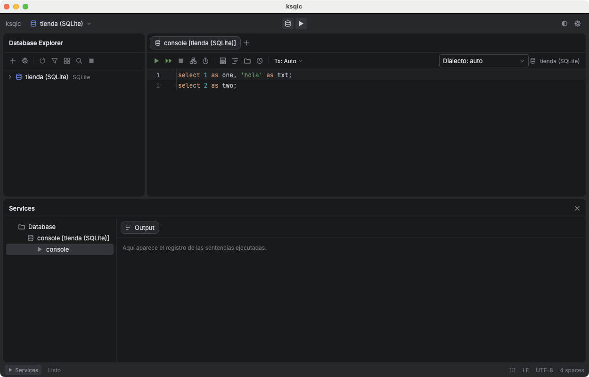

# ksqlc (karl-sql-client)

Cliente SQL de escritorio multiplataforma (macOS, Linux y Windows), escrito en Kotlin con Compose Desktop. Su interfaz y sus funciones están inspiradas en DataGrip; el código es propio.



## Motores

PostgreSQL, MySQL, MariaDB, SQLite, SQL Server, Oracle y Apache Cassandra. Los drivers JDBC van dentro de la aplicación; no hay que instalarlos.

## Qué hace

- **Varios data sources y varias consolas a la vez**, con carpetas, colores, modo solo lectura y transacciones Auto/Manual por conexión.
- **Túnel SSH y SSL/TLS**: contraseñas y frases de paso en el llavero del sistema, nunca en `connections.json`.
- **Database Explorer**: árbol de esquemas, tablas, columnas, índices y claves foráneas; filtro, búsqueda y refresco automático.
- **Consola y editor SQL**: ejecutar sentencia, selección o script; autocompletado, ir a la declaración, parámetros `:nombre`, plan de ejecución, historial por conexión.
- **Resultados y datos**: pestañas de resultados con paginación, edición de celdas con vista previa del DML, columnas redimensionables.
- **DDL**: ver, copiar y modificar tablas; eliminar, vaciar y ejecutar rutinas.
- **Importar y exportar**: CSV, TSV, JSON y SQL `INSERT`; importar CSV con asignación de columnas; volcado y restauración nativos (`pg_dump`, `mysqldump`, `sqlite3`).
- **Comparar y copiar**: diff de esquemas, diff de contenido de tablas con «Sincronizar derecha», y copiar una tabla a otro data source.

El detalle y el estado de cada función está en [`docs/spec/feature-inventory.md`](docs/spec/feature-inventory.md).

## Ejecutar desde el código fuente

Hace falta un JDK 21. `run.sh` busca uno (variable `KSQLC_JAVA_HOME`, `JAVA_HOME`, SDKMAN o `java_home` de macOS) y lanza Gradle con él:

```
./run.sh          # abre la aplicación
./run.sh test     # tests (los de integración usan Testcontainers y se omiten si no hay Docker)
```

Los data sources se guardan en `~/.ksqlc/`.

## Generar ejecutables

`jpackage` no compila en cruzado: cada sistema operativo genera sus propios paquetes. Incluyen un JRE, así que el usuario final no necesita instalar Java.

| Sistema | Script | Resultado en `dist/` |
|---|---|---|
| macOS | `./build.sh` | `.dmg` y zip portable |
| Linux | `./build.sh` | `.deb` y zip portable |
| Windows | `.\build.ps1` (JDK 21 en `JAVA_HOME`) | `.msi` y zip portable |

El workflow [`release.yml`](.github/workflows/release.yml) hace los tres a la vez en GitHub Actions: se lanza a mano (los paquetes quedan como artefactos de la ejecución) o al subir un tag `v*`, que además publica una Release con todos los archivos. El tag tiene que coincidir con `packageVersion` de `app/build.gradle.kts` (`v1.2.0` ↔ `"1.2.0"`); si no, el workflow falla. Los instaladores no están firmados, así que macOS (Gatekeeper) y Windows (SmartScreen) mostrarán un aviso al abrirlos.

## Estructura

| Módulo | Contenido |
|---|---|
| `core` | Modelo común: data sources, resultados, esquema |
| `sql` | Análisis de SQL |
| `drivers` | Conexiones JDBC, introspección y dialectos por motor |
| `storage` | Conexiones, ajustes, historial y llavero |
| `app` | Interfaz (Compose Desktop) |

## Licencia

GNU GPL v3. Ver [`LICENSE`](LICENSE). El código fuente de cada versión es el del tag correspondiente de este repositorio.

### Licencias de terceros

Los instaladores incluyen, sin modificar, los drivers JDBC de SQLite, PostgreSQL, MySQL, MariaDB, SQL Server, Oracle y Cassandra, cada uno con su propia licencia (el de Oracle es propietario, con permiso de redistribución gratuita). La lista completa de componentes y los textos de licencia están en [`packaging/resources/common/`](packaging/resources/common/THIRD-PARTY-NOTICES.md) y también dentro de cada paquete.
